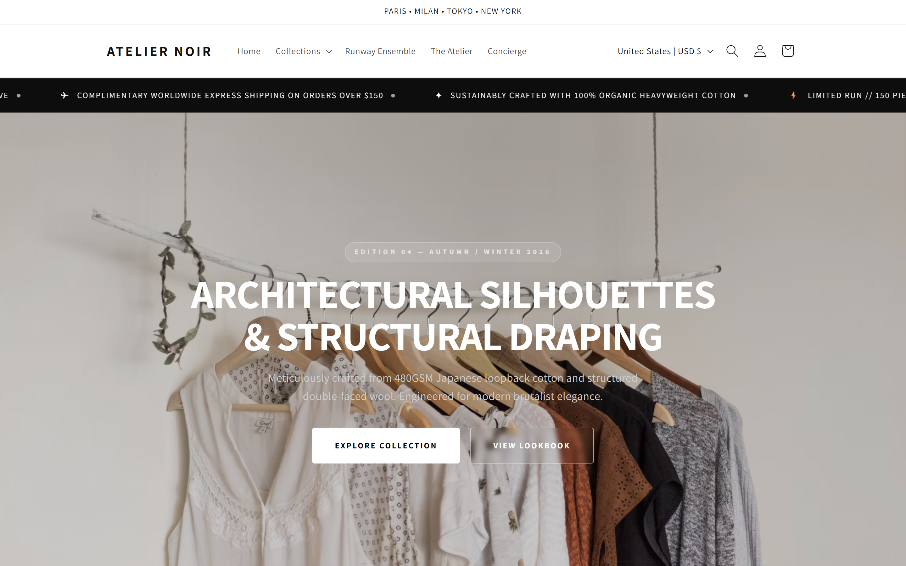
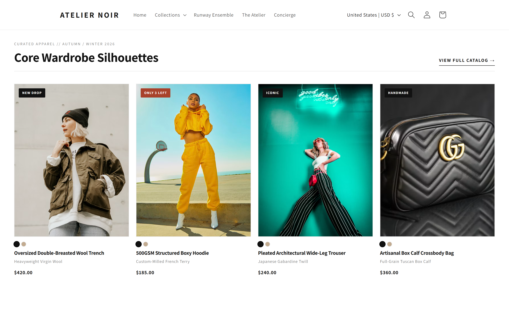
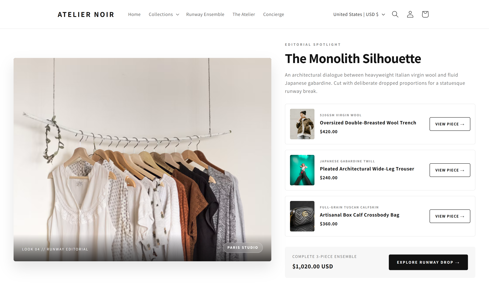
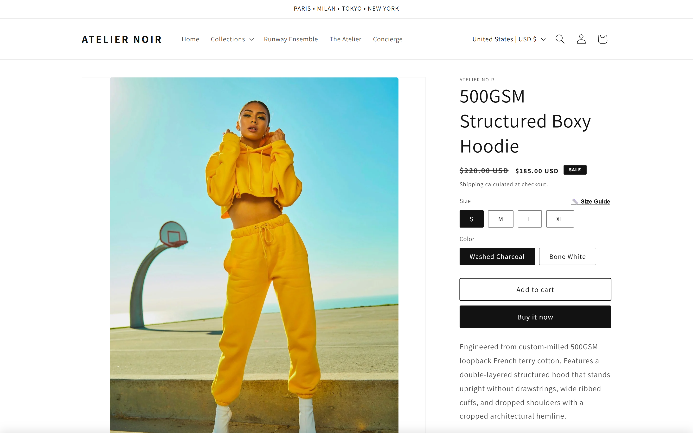
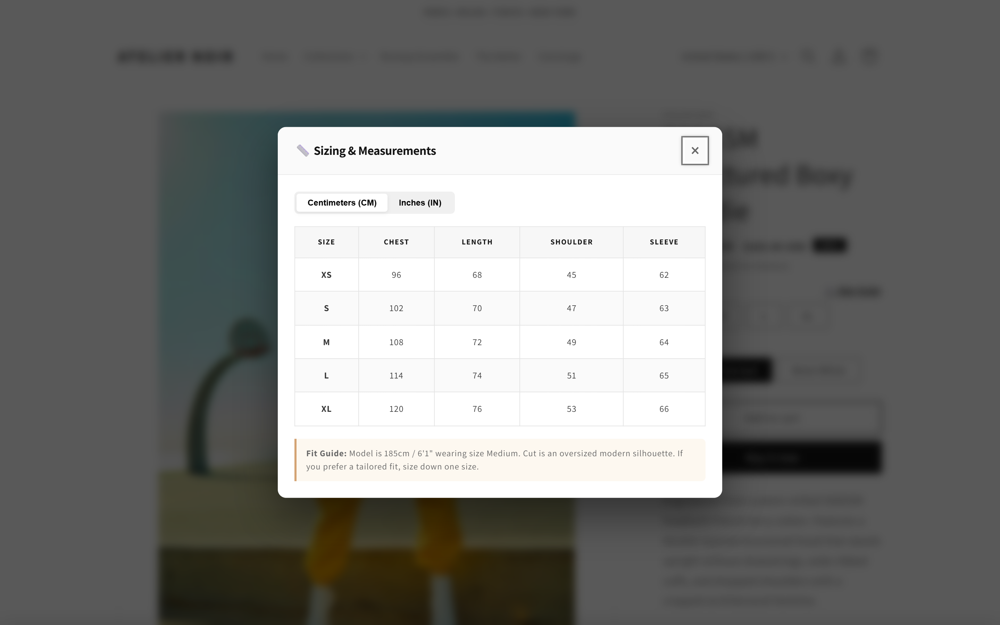
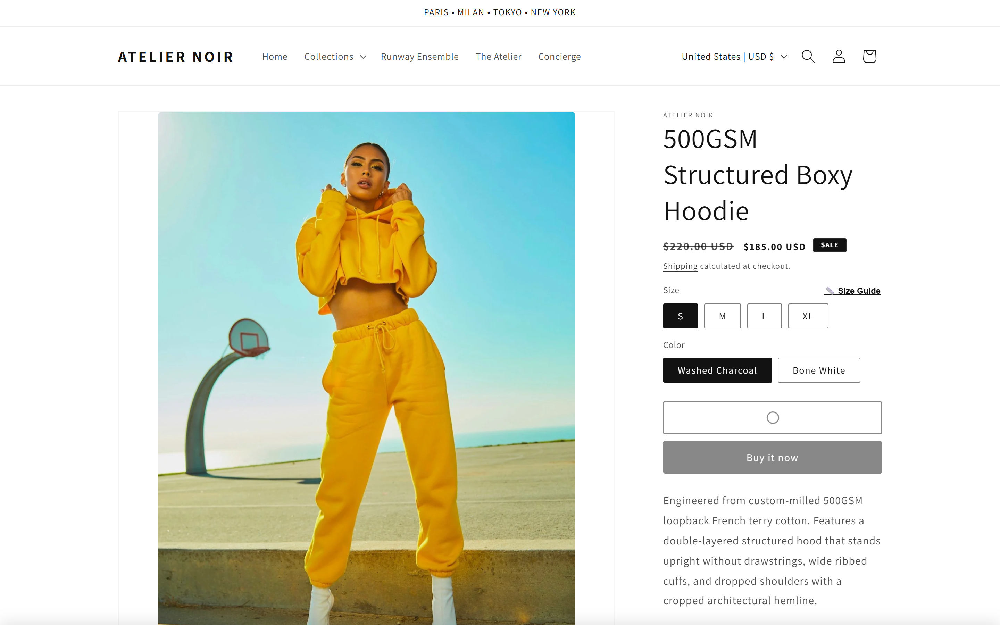
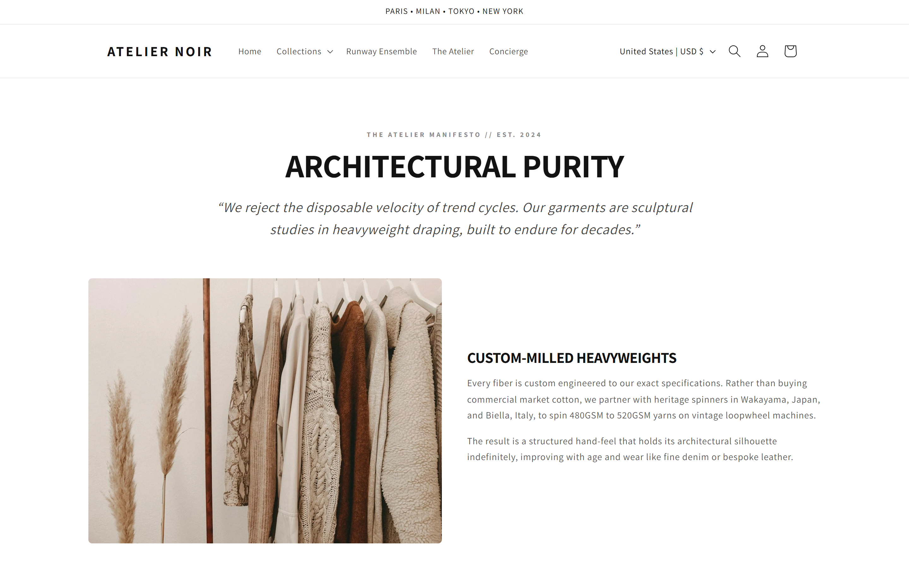
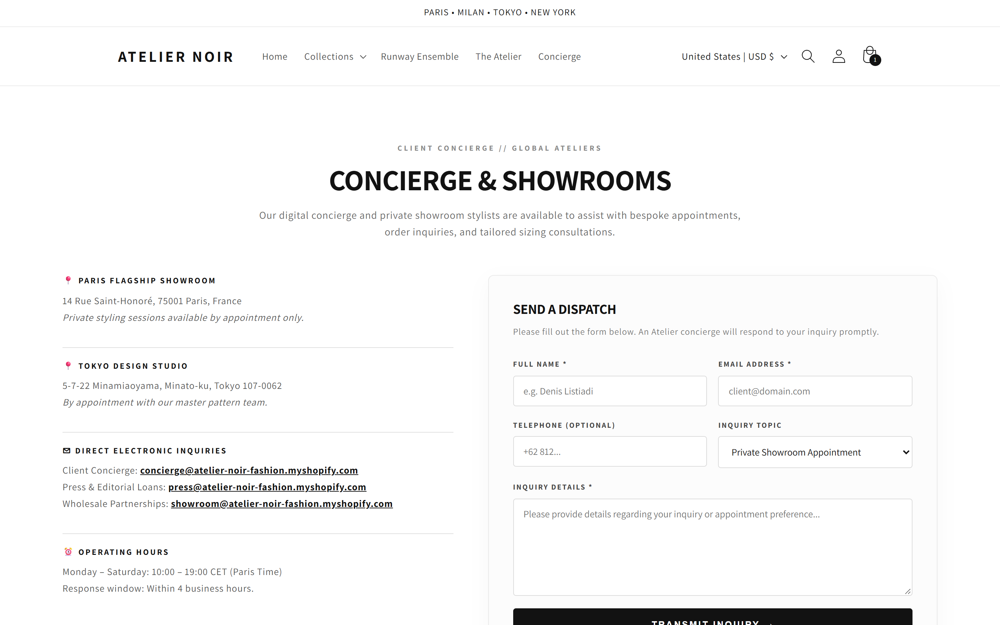

# Atelier Noir — Shopify OS 2.0 Fashion Theme

A custom, high-performance Shopify Online Store 2.0 theme crafted for contemporary fashion and luxury apparel brands. Built with native Liquid, modern vanilla JavaScript, and zero external app dependencies.

**Live Store:** [atelier-noir-fashion.myshopify.com](https://atelier-noir-fashion.myshopify.com)  
**Storefront Password:** `yeotwo`  
**Built with:** Shopify CLI, Dawn architecture, Liquid, Vanilla JS (ES6+), CSS Grid/Flexbox

---

## Visual Previews

### 1. Homepage & Curated Fashion Showcase


*Curated Collection Showcase with 1-click Quick Add & secondary image hover preview:*


*Editorial Runway Lookbook (Split-view ensemble garment breakdown):*


---

### 2. Product Detail Page (PDP)
*Custom 600px width media gallery with circular arrow navigation and centered thumbnail slider:*


*Interactive Size Guide modal with instant Centimeters (CM) / Inches (IN) conversion:*


---

### 3. High-Conversion Cart Drawer
*AJAX Cart Drawer with real-time dynamic Free Shipping meter ($150 goal) and instant line-item controls:*


---

### 4. Storytelling & Concierge Pages
| Brand Manifesto (`/pages/about`) | Client Concierge (`/pages/contact`) |
| :---: | :---: |
|  |  |

---

## Why this project?

Most Shopify fashion stores suffer from performance degradation and high recurring costs because they rely on third-party apps for basic features: shipping calculators, size guides, product swatches, lookbooks, and sticky cart bars. Each app injects external scripts, stylesheets, and tracking pixels that drag down PageSpeed and introduce layout shifts (CLS).

**Atelier Noir** was built to demonstrate that advanced e-commerce functionality can—and should—be engineered natively into the theme:

- **0 Monthly App Costs:** Features typically billed at $15–$50/month each are built directly into Liquid templates.
- **Pure Native Stack:** Built on modern Web Components and standard Shopify Section Rendering APIs. No jQuery, no bloated libraries.
- **Core Web Vitals First:** Fixed 3:4 aspect ratios to eliminate layout shifts, prioritized LCP assets, and deferred non-critical scripts.

---

## Key Features

### 1. AJAX Cart Drawer with Dynamic Free Shipping Tier
- Real-time remaining balance calculation towards free shipping ($150 default threshold).
- Seamless quantity increments and line-item removals powered by Shopify Section Rendering API without full-page reloads.
- Configurable free shipping threshold directly editable from Shopify Theme Settings (`Theme Settings → Cart`).

### 2. Product Detail Page (PDP) Media Gallery
- Responsive thumbnail slider with support for touch swiping on mobile and circular arrow navigation on desktop.
- Smart layout handling that prevents viewport jump (`window.scrollTo`) when cycling through images.
- Desktop layout constrained to a balanced 600px width with automatic centering and smooth hover transitions.

### 3. Native Size Guide Modal with Unit Converter
- Interactive unit toggle: switches instantly between Centimeters (CM) and Inches (IN).
- Portaled directly to `document.body` for consistent viewport positioning across iOS, Android, and desktop.
- Backdrop blur with smooth ESC and click-outside dismissal.

### 4. Custom Online Store 2.0 Sections
- **Runway Lookbook & Editorial Spotlight (`sections/editorial-spotlight.liquid`):** Split-view editorial showcase linking a campaign photo with individual garment cards and quick links.
- **Curated Product Showcase (`sections/fashion-product-grid.liquid`):** 4-column luxury grid with secondary hover preview, variant color dots, and one-click quick add.
- **Infinite Marquee Announcement (`sections/announcement-marquee.liquid`):** Smooth scrolling ticker with pause-on-hover.
- **Showroom & Concierge Contact Page (`sections/fashion-contact.liquid`):** Multi-column layout featuring flagship address details, departmental inquiries, and native contact form integration.
- **Brand Story Manifesto (`sections/fashion-about.liquid`):** Editorial storytelling layout detailing textile sourcing and craftsmanship.

---

## Tech Stack & Architecture

| Layer | Technologies & Techniques |
| :--- | :--- |
| **Templating** | Shopify Liquid (OS 2.0 JSON templates, custom sections & snippets) |
| **JavaScript** | Native ES6+, Custom Elements (Web Components), Section Rendering API, IntersectionObserver |
| **Styling** | Modular CSS, CSS custom properties, Flexbox, CSS Grid, aspect-ratio |
| **Tooling** | Shopify CLI 5.x, Theme Check, Git, GitHub Actions CI |

---

## Project Structure

```text
├── assets/
│   ├── component-card.css         # Product card styling & hover states
│   ├── media-gallery.js           # Touch slider & gallery interactions
│   ├── section-main-product.css   # PDP media gallery & layout rules
│   └── cart-drawer.js             # AJAX cart operations
├── config/
│   ├── settings_data.json         # Typography, colors & default configuration
│   └── settings_schema.json       # Custom theme settings (cart threshold, etc.)
├── docs/
│   └── screenshots/               # High-resolution desktop storefront previews
├── layout/
│   ├── theme.liquid               # Global HTML document shell
│   └── password.liquid            # Coming soon / password protection page
├── sections/
│   ├── announcement-marquee.liquid # Ticker banner
│   ├── editorial-spotlight.liquid  # Split-screen lookbook section
│   ├── fashion-about.liquid        # Brand story page section
│   ├── fashion-contact.liquid      # Showroom & customer service contact
│   ├── fashion-ethos.liquid        # Craftsmanship pillars
│   ├── fashion-hero.liquid         # Hero banner with fetchpriority optimization
│   └── fashion-product-grid.liquid # 4-column collection grid with quick add
├── snippets/
│   ├── cart-free-shipping-bar.liquid # Dynamic free shipping calculation
│   ├── product-media-gallery.liquid  # Media viewer & thumbnail slider
│   ├── size-guide-modal.liquid       # Interactive CM/IN size chart
│   └── sticky-add-to-cart.liquid     # Bottom sticky conversion bar
└── templates/
    ├── index.json                  # Modular homepage structure
    ├── product.json                # Product page layout & block schema
    ├── collection.json             # Collection catalog page
    ├── page.about.json             # Brand manifesto template
    └── page.contact.json           # Contact page template
```

---

## Development Setup

To run and preview this theme locally:

### Prerequisites
- Node.js (v18+)
- Shopify CLI: `npm install -g @shopify/cli`
- A Shopify Partner or development store

### Commands

```bash
# Clone the repository
git clone https://github.com/denislistiadi/atelier-noir-fashion.git
cd atelier-noir-fashion

# Install local dependencies
npm install

# Start development server with live reload
shopify theme dev --store atelier-noir-fashion.myshopify.com

# Run Theme Check linter
shopify theme check

# Push changes to a specific theme
shopify theme push --store atelier-noir-fashion.myshopify.com --theme <THEME_ID>
```

---

## Author

**Denis Listiadi**  
- GitHub: [@denislistiadi](https://github.com/denislistiadi)  
- Email: denislistiadi24@gmail.com  
- Project: [atelier-noir-fashion](https://github.com/denislistiadi/atelier-noir-fashion)

---

## License

- Base theme structure derived from [Shopify Dawn](https://github.com/Shopify/dawn), licensed under the MIT License.
- Product imagery sourced from [Unsplash](https://unsplash.com) for demonstration purposes under the Unsplash License.
